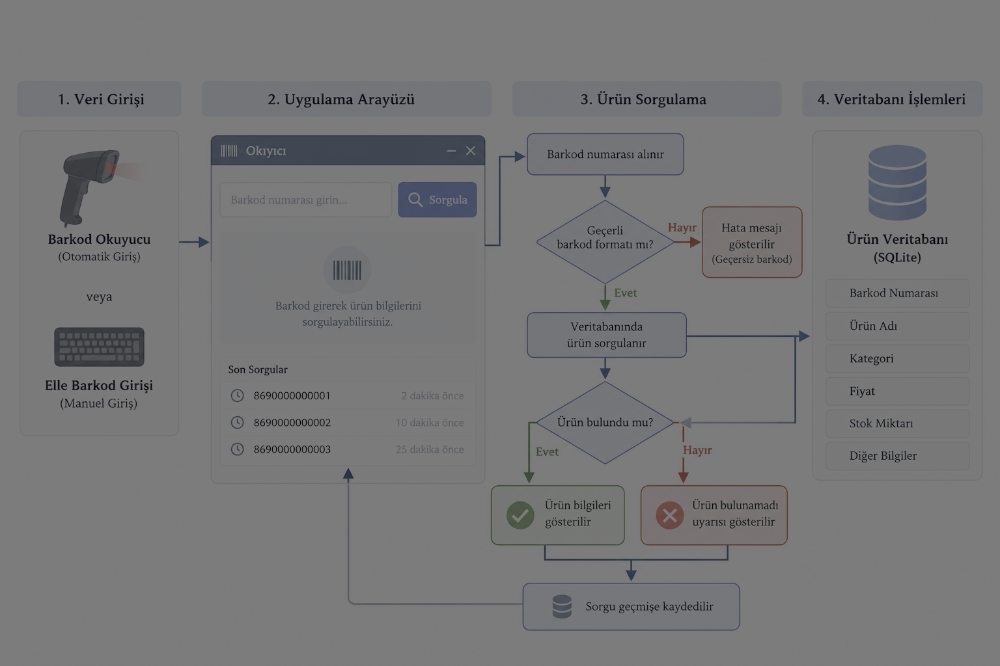

## Okıyıcı Sistemi Çalışma Akışı

Okıyıcı, ürün etiketlerindeki barkod bilgisini kullanarak ürün bilgilerine erişmeyi amaçlayan bir uygulamadır. Aşağıdaki şema, sistemin planlanan temel çalışma akışını göstermektedir.

### Temel işlem adımları

1. Barkod numarası manuel olarak girilir veya barkod okuyucu ile alınır.
2. Girilen barkod bilgisi kontrol edilir.
3. Ürün, veritabanında barkod numarasına göre sorgulanır.
4. Ürün bulunursa bilgileri kullanıcıya gösterilir; bulunamazsa uyarı verilir.
5. Sorgulama sonucu geçmiş kayıtlarına eklenir.

> **Geliştirme durumu:** Bu şema hedeflenen sistem akışını göstermektedir. Kamera ile barkod okuma, API ve veritabanı entegrasyonları geliştirme aşamalarında tamamlanacaktır.
 
